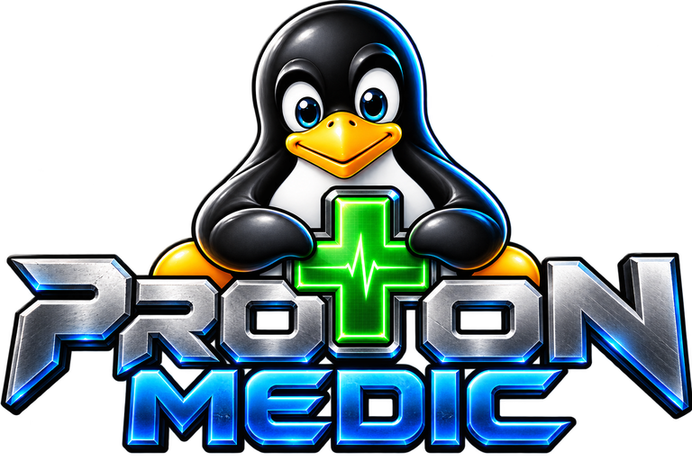

# Proton Medic

<p align="center"></p>

Proton Medic helps Linux players diagnose game problems, manage installed Proton versions, and apply repairs with backups and rollback.

**Version:** v0.6.28 · [Downloads](https://github.com/relentlesspoetry-coder/Proton-medic/releases/latest)

## Features

- Browse Steam and Windows games together in Library, with source filters, saved favorites, and recently played sorting.
- Find native and Flatpak Steam installations, game libraries, and installed Proton tools.
- Download official GE-Proton releases with checksum verification, progress, and cancellation. Keep versions side by side and choose one per game.
- Analyze Proton logs and check Vulkan and system information.
- Recommend installed compatibility tools based on game settings and log findings.
- Launch selected Steam games and inspect new logs.
- Configure per-game Proton logging and monitor logs for changes.
- Apply supported configuration fixes with backups and selective rollback.
- Run trusted Windows `.exe` installers using an installed Wine or Proton runtime.
- Review suggested executables after setup, preview the embedded icon, and confirm the game name and optional shortcuts.
- Save per-game runtime, literal launch arguments, and working directory settings with backups and reset support.
- Register installed Windows games using their existing prefix, including game files on other drives.
- Create desktop and applications-menu shortcuts that reuse a game’s saved environment and extracted icon.
- Optionally monitor CPU, RAM, peak RAM, and observed child processes for a running Windows game or installer.
- View recent Windows game and installer runs with runtime names, exit results, and log error summaries.
- Rename Windows game profiles, remove them from the list, and restore them without deleting game files.
- Display embedded Windows game icons and locally cached Steam artwork.
- Preview and export a local troubleshooting report with personal paths redacted by default.
- Check for signed GitHub updates when requested.
- Use a blue glass interface with bundled fonts.

The update button appears at the top right on every page, with the installed version directly below it.

## Install

### Steam Deck / SteamOS

1. Switch to **Desktop Mode** and download `proton-medic_0.6.28_amd64.AppImage` from [Releases](https://github.com/relentlesspoetry-coder/Proton-medic/releases/latest).
2. Move it to a permanent folder such as `~/Applications`. Game shortcuts refer to this location.
3. In Dolphin, open **Properties → Permissions**, enable **Is executable**, then open the AppImage.

GTK, WebKitGTK, and application fonts travel with the AppImage. No DEB installation, administrator password, or change to SteamOS read-only protection is needed. The app updates this same file automatically; keep its folder writable.

If the system reports that FUSE is missing, run it without FUSE from Konsole:

```bash
APPIMAGE_EXTRACT_AND_RUN=1 "$HOME/Applications/proton-medic_0.6.28_amd64.AppImage"
```

The portable package is built on Ubuntu 22.04 for x86_64 systems with glibc 2.35 or newer. Graphics drivers and the desktop session come from the operating system. Steam and an installed Proton or Wine runtime are required for their respective game-launching features; the application does not install or replace graphics drivers. GE-Proton downloads are available from Proton versions; Valve Proton and Proton Experimental remain managed by Steam.

### Ubuntu / Debian-compatible desktops

Download the amd64 DEB and install it using a package manager so that dependencies are installed too:

```bash
sudo apt install ./proton-medic_0.6.28_amd64.deb
```

The DEB requires an Ubuntu 24.04-compatible x86_64 system with glibc 2.39 or newer, GTK 3, and WebKitGTK 4.1. Use the AppImage on SteamOS. Existing installations can check for signed updates in the app.

## Proton versions

Open **Proton versions → Load latest releases**, choose a detected native or Flatpak Steam installation and GE-Proton version, approve the download, and select **Download and install**. **Older releases** loads previous versions. Downloads come from GloriousEggroll's official GitHub repository and are checked against the release's SHA-512 checksum before extraction. Existing versions are never replaced.

Keep Proton Medic open until installation finishes. Progress and cancellation remain available on the Proton versions page. Restart Steam afterward so it discovers the new compatibility tool.

For a Steam game, open **Library → game → Proton**, choose a version available to that Steam installation, close Steam, and approve **Use selected Proton**. The previous Steam configuration is backed up. Installing a version does not automatically change any game's selection.

For a Windows game, open **Game settings and logs → Edit launch settings**. Downloaded GE-Proton versions in native Steam use **umu-launcher** (`umu-run` on PATH), as required for supported GE-Proton launches outside Steam. Install UMU through your distribution first; these versions are not offered to Windows games until UMU is available. The saved prefix, executable, working directory, and literal arguments are retained. Flatpak Steam downloads are available to Flatpak Steam only. Existing unmanaged runtimes remain available.

Valve's official Proton and Proton Experimental are installed and updated through **Steam → Library → Tools**. GE-Proton is a community build, and newer versions are not guaranteed to work better for every game.

## Unified library

**Library** combines scanned Steam games and visible Windows game profiles. Search both sources, filter by Steam or Windows, and use the star beside a game to save it as a favorite. Favorites are stored locally and remain separate for different installations and game sources.

Choose **Recently played** to sort by available Steam manifest dates and recorded Windows game launches. Unknown dates appear last; installer runs and failed runtime starts do not replace a Windows game’s previous launch date. These dates describe recorded activity, not verified gameplay or playtime.

Open a Steam game for diagnostics and repair tools, or a Windows game for its existing launch controls, settings, history, monitoring, and shortcuts. **Back to My Games** preserves the search, filters, and sorting. **Windows Games** remains available for installing, adding, and restoring profiles.

## Troubleshooting reports

Open **Settings → Create report**. Choose Steam diagnostics, Windows game status, and optional recent Windows launch history, then select **Generate preview**. System details are always included. Review the exact JSON contents, approve saving, and choose a new `.json` file. Reports stay local until you share them yourself.

Personal paths are redacted by default: any path-bearing text field is replaced in full. Game names, runtime names, and selected launch timestamps remain visible. Turning redaction off includes the selected paths. Raw logs, log excerpts, launch arguments, environment variables, account data, removed profiles, and resource samples are excluded in either mode.

Reports include at most 100 Steam games, 50 visible Windows games, and the latest 20 recorded runs per Windows game. Omitted counts and unavailable data are marked. Steam inventory may be cached for up to 30 seconds; log findings are collected when generating the preview. Generating a report does not run a Vulkan probe or launch a game. Saved reports use the reviewed snapshot and never replace an existing file.

## Windows game launchers

Open **Windows Games**, select the installed game’s `.exe` in its card, then choose **Create desktop shortcut**. Shortcuts launch through Proton Medic’s native launcher using the saved runtime, prefix, and working directory. The main window does not need to be open. GNOME may ask you to **Allow Launching** on first use.

When setup closes successfully, the game card suggests likely executables. Choose the correct file, review its name and icon, approve saving, and optionally request desktop shortcuts. Suggestions never launch a game automatically.

Expand **Game settings and logs → Edit launch settings** to select a runtime, enter one launch argument per line, or choose a working directory. Spaces inside each argument are preserved. Changes keep the same prefix and are backed up. **Reset launch settings** restores the original runtime, clears arguments, and uses the executable’s folder; the current settings are backed up first. Existing shortcuts automatically use saved settings.

Expand **Launch history** on a Windows game card to view its latest 20 recorded runs, including desktop shortcut launches. Entries show the runtime used, start time, elapsed time when available, runtime exit result, and recognized log errors. Unknown exits and interrupted runs are labeled explicitly. History begins with v0.6.16; existing logs remain available. Exit code 0 does not confirm that gameplay worked correctly.

While a game or installer is running, choose **Monitor resources** on its Windows game card. The panel shows CPU usage, estimated resident RAM, peak RAM during monitoring, process count, and a short memory trend. Monitoring is off by default, follows one selected game, and pauses when the window is hidden. It also works with Proton Medic desktop shortcuts. Readings include observed child processes; CPU 100% represents one core, and shared memory can be counted more than once in RAM totals.

Use **Add installed game** for an installation missing from the list. Select its executable and the existing prefix containing `drive_c` and `system.reg`; use the runtime that previously ran it. This registers the game without reinstalling or copying it. Games installed through Proton Medic may initially appear under their installer’s name. Use **Rename** on the game card to change its display name. **Remove from list** hides the profile while preserving its game files, prefix, and shortcuts. Expand **Removed games** to restore it.

## Build

Install Rust 1.99.1, Node.js 22 or newer, and the dependencies listed in [BUILDING.md](BUILDING.md).

```bash
npm ci
bash scripts/build-zorin.sh --check
bash scripts/build-zorin.sh --build
```

Use `npm run dev` for the frontend or `npm run tauri -- dev` for the desktop app.

## Session safety

Games sharing a Windows prefix run one at a time through Proton Medic, including desktop shortcuts. App updates wait for active work across Proton Medic processes using the same application data directory. The main window stays open while it supervises games, installers, downloads, or unfinished repair work. Finish that work before closing. Force-quitting the process or shutting down Linux can still interrupt supervision.

## How repairs and updates work

Scans and log analysis stay on your computer. Configuration changes preserve backups and require Steam to be closed. Concurrent configuration writes from Proton Medic instances are excluded. Automatic Proton selection uses versions available to the game’s Steam installation. Game launches and manual repairs require approval. Automatic fixes are optional and limited to supported log findings. If logging setup is waiting for Steam to close, open **Game log updates → Cancel queued log setup** to cancel without changing Steam settings.

Update checks contact GitHub only when requested. Packages are signature-verified before installation. System package installation may request administrator approval. After installation, Proton Medic automatically reopens into the installed version. Finish active Windows games, installers, queued logging setup, and Fix & Test sessions before updating.

Proton Medic does not bypass anti-cheat or DRM. Launch status and log findings help diagnose a game; the player confirms whether it runs correctly. Windows installers run with your user permissions, so use trusted files.

## Documentation

- [Build instructions](BUILDING.md)
- [Signed releases and updater setup](GITHUB-RELEASES.md)
- [v0.6.6 changes](RELEASE-v0.6.6.md)
- [v0.6.7 changes](RELEASE-v0.6.7.md)
- [v0.6.8 changes](RELEASE-v0.6.8.md)
- [v0.6.9 changes](RELEASE-v0.6.9.md)

- [v0.6.10 changes](RELEASE-v0.6.10.md)
- [v0.6.11 changes](RELEASE-v0.6.11.md)
- [v0.6.12 changes](RELEASE-v0.6.12.md)

- [v0.6.13 changes](RELEASE-v0.6.13.md)

- [v0.6.14 changes](RELEASE-v0.6.14.md)

- [v0.6.15 changes](RELEASE-v0.6.15.md)

- [v0.6.16 changes](RELEASE-v0.6.16.md)

- [v0.6.17 changes](RELEASE-v0.6.17.md)

- [v0.6.18 changes](RELEASE-v0.6.18.md)
- [v0.6.19 changes](RELEASE-v0.6.19.md)
- [v0.6.20 changes](RELEASE-v0.6.20.md)
- [v0.6.21 changes](RELEASE-v0.6.21.md)
- [v0.6.22 changes](RELEASE-v0.6.22.md)
- [v0.6.27 changes](RELEASE-v0.6.27.md)
- [v0.6.28 changes](RELEASE-v0.6.28.md)
